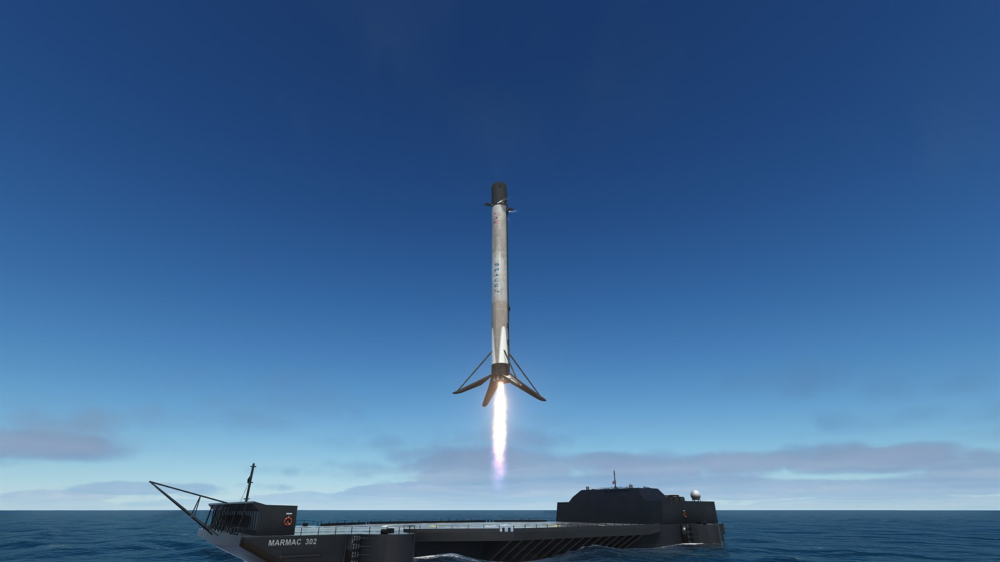

# kOS-Falcon-GNC

[](https://github.com/tthirteenttt/kOS-Falcon-GNC/releases)
[-blue)](https://tthirteenttt.github.io/kOS-Falcon-GNC/getting-started/installation.html)
[](https://tthirteenttt.github.io/kOS-Falcon-GNC/)
[](https://youtu.be/fHC-j8KP-JU)
[](LICENSE)

Autonomous Falcon 9 Block 5 (`Ghidorah 9`) launch, upper-stage orbital insertion (**UPEG**), and first-stage booster recovery (**ASDS / RTLS**) kOS autopilot for **Kerbal Space Program 1.12.x** (**RSS / Sol + Realism Overhaul + FAR**). Includes a standalone, non-destructive MIT **RO / FAR / Waterfall** ModuleManager patch suite for Tundra Exploration and KRE.



---

## Key Features

- **Pre-Flight Predictor (`estimate.ks`)** — Runs on the launchpad to check Stage 1 recovery fuel margin, Max-Q, and Stage 2 delta-V, and saves the predicted drone ship coordinates (`0:/config/asds_predicted.ks`).
- **Ascent & Orbital Insertion (`ascent.ks`)** — Auto-warps to `FIXED` LAN launch windows, flies an AoA-safe gravity turn, handles Stage 2 RCS ullage and MVac ignition, and guides Stage 2 to `< 1 km` insertion accuracy (LEO, SSO, MEO, GTO).
- **ASDS & RTLS Booster Recovery (`recovery.ks`)** — Handles flip, RTLS boostback, stowed grid-fin deflection lock/unlock, 3-engine entry burn, grid-fin glide (with automatic RCS shutoff to save Nitrogen), and single-engine Hoverslam touchdown (`< 0.2 m` verified accuracy).
- **Standalone RO / FAR / Waterfall Patches** — 8 non-destructive MIT ModuleManager configs covering Tundra Exploration, Tundra Technologies, and KRE without overwriting any upstream mod files.
- **Flight Demo** — [Watch the full mission on YouTube](https://youtu.be/fHC-j8KP-JU).

---

## Quick Install

- **Manual Installation (Current)**: Download the latest zip from [GitHub Releases](https://github.com/tthirteenttt/kOS-Falcon-GNC/releases) and extract:
  1. `GameData/kOS-Falcon-GNC/` → `<KSP_ROOT>/GameData/`
  2. `Ships/Script/*` → `<KSP_ROOT>/Ships/Script/`
  3. `Ships/VAB/Falcon9forRecovery.craft` → `<KSP_ROOT>/saves/<YourSave>/Ships/VAB/`
- **CKAN**: *Pending maintainer review (not yet available on CKAN).*

> See [Installation & Dependencies](https://tthirteenttt.github.io/kOS-Falcon-GNC/getting-started/installation.html) for the required mod links and upgrade cleanup steps.

---

## Quick Start (3 Commands)

1. **Pre-flight prediction (on the pad, any kOS terminal)**:
   ```kerboscript
   SWITCH TO 0. RUN estimate.
   ```
2. **Launch & Stage 2 orbital insertion (Stage 2 terminal — press `SPACE` ASAP after ignition to release clamps, again at MECO to separate Stage 1, and again above `91 km` to jettison fairings)**:
   ```kerboscript
   SWITCH TO 0. RUN ascent.
   ```
3. **Stage 1 booster recovery (switch back via FMRS, Stage 1 terminal)**:
   ```kerboscript
   SWITCH TO 0. RUN recovery.
   ```

---

## Documentation (GitHub Pages)

Full guides, staging checks, config tables, and technical references are hosted on **[GitHub Pages](https://tthirteenttt.github.io/kOS-Falcon-GNC/)**:

| Topic | Link |
| :--- | :--- |
| **Installation & Dependencies** | [Getting Started — Installation](https://tthirteenttt.github.io/kOS-Falcon-GNC/getting-started/installation.html) |
| **Vessel & Staging Setup** | [Getting Started — Vessel Setup](https://tthirteenttt.github.io/kOS-Falcon-GNC/getting-started/vessel-setup.html) |
| **Mission Workflow (English)** | [Mission Guide — Workflow (EN)](https://tthirteenttt.github.io/kOS-Falcon-GNC/guide/mission-workflow.html) |
| **使用教程（中文）** | [Mission Guide — 中文使用教程](https://tthirteenttt.github.io/kOS-Falcon-GNC/guide/mission-workflow-zh.html) |
| **Configuration Reference** | [Mission Guide — Config Parameters](https://tthirteenttt.github.io/kOS-Falcon-GNC/guide/configuration.html) |
| **GNC & Software Architecture** | [Technical — GNC Architecture](https://tthirteenttt.github.io/kOS-Falcon-GNC/technical/gnc-architecture.html) |
| **RO / FAR / Waterfall Patch Suite** | [Technical — Patch Suite & Data Table](https://tthirteenttt.github.io/kOS-Falcon-GNC/technical/ro-far-patches.html) |
| **Envelope, Known Issues & Roadmap** | [Reference — Known Issues & Roadmap](https://tthirteenttt.github.io/kOS-Falcon-GNC/reference/known-issues.html) |

---

## License & Credits

- Released under the **MIT License** (see [LICENSE](LICENSE)).
- RO / FAR / Waterfall patches target **Tundra Exploration** (Damonvv), **Tundra Technologies**, **Kerbal Reusability Expansion** (EmbersArc), **Realism Overhaul**, and **FAR Continued** without modifying upstream files.
- SpaceX / Falcon / Dragon decal textures in `GameData/kOS-Falcon-GNC/Textures/` are modified from **[nessux/TundraExploration4RO](https://github.com/nessux/TundraExploration4RO)** under the **MIT License**.
- Companion mod: **[ASDS-Manager](https://github.com/tthirteenttt/ASDS-Manager)** for automatic drone-ship deployment and deck locking.
- Developed with assistance from **Google Gemini** for GNC modeling, aerospace data verification, ModuleManager patching, and documentation.
