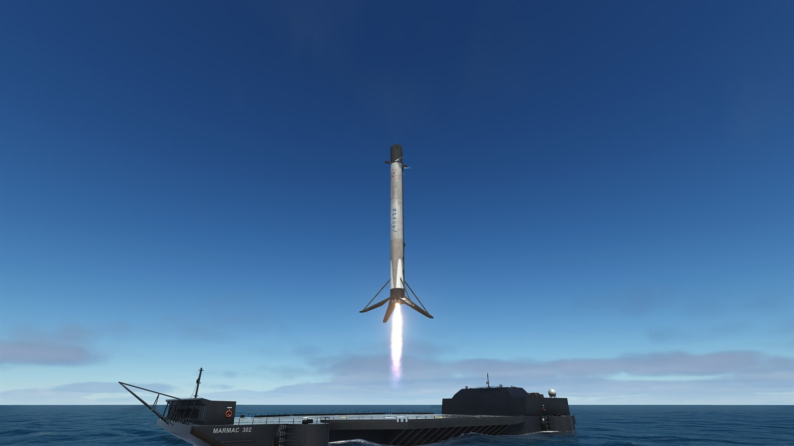
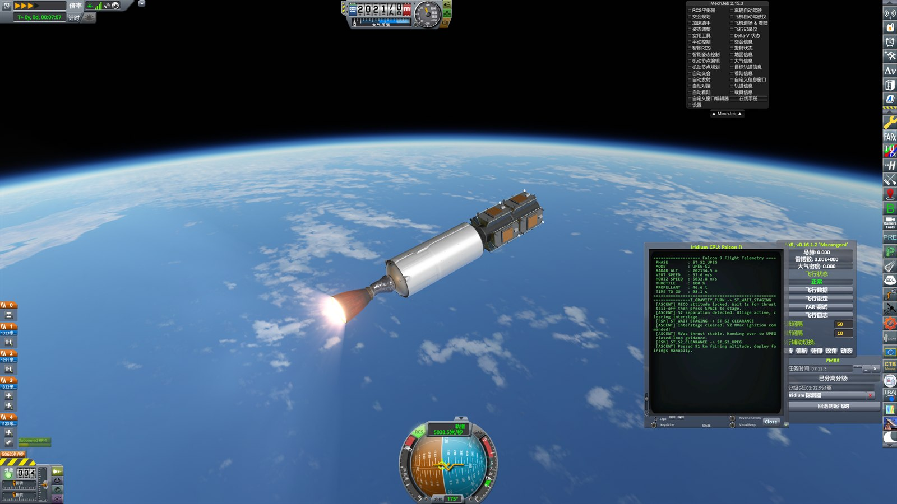
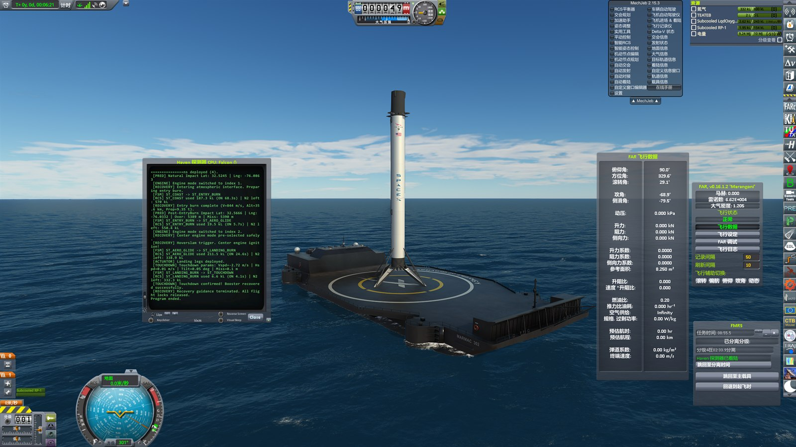
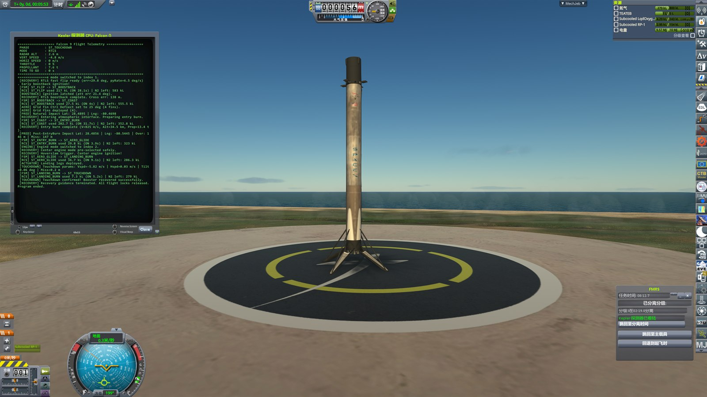

# kOS-Falcon-GNC
{: .fs-9 }

Autonomous Falcon 9 Block 5 (`Ghidorah 9`) launch, upper-stage orbital insertion (UPEG), and first-stage booster recovery (**ASDS** / **RTLS**) kOS autopilot for **Kerbal Space Program 1.12.x** (**RSS / Sol + Realism Overhaul + FAR**).
{: .fs-6 .fw-300 }

[Mission Workflow (EN)](guide/mission-workflow.html){: .btn .btn-primary .fs-5 .mb-4 .mb-md-0 .mr-2 }
[使用教程 (中文)](guide/mission-workflow-zh.html){: .btn .fs-5 .mb-4 .mb-md-0 .mr-2 }
[Watch Demo Video](https://youtu.be/fHC-j8KP-JU){: .btn .fs-5 .mb-4 .mb-md-0 }

---

## Highlights

- **Pre-Flight Trajectory Predictor (`estimate.ks`)**: Runs on the launchpad before liftoff to check Stage 1 fuel margin, Max-Q, and Stage 2 delta-V, and automatically saves the optimal ASDS coordinates (`0:/config/asds_predicted.ks`).
- **Ascent & Closed-Loop Insertion (`ascent.ks`)**: Auto-warps to `FIXED` LAN launch windows, protects against aerodynamic flip during gravity turn, runs Stage 2 RCS ullage + MVac ignition, and hits target orbits (LEO, SSO, MEO, GTO) to `< 1 km`.
- **Autonomous ASDS & RTLS Recovery (`recovery.ks`)**: Executes flip, RTLS boostback, grid-fin deployment (locked to `0°` during ascent and unlocked to `25°` on deploy), 3-engine entry burn, aerodynamic glide with automatic high-Q RCS shutoff, and single-engine Hoverslam touchdown (`< 0.2 m` verified accuracy).
- **Standalone RO / FAR / Waterfall Patches**: Includes non-destructive MIT ModuleManager configs covering all **99 parts** across Tundra Exploration, Tundra Technologies, and KRE — zero upstream mod files overwritten.

---

## Flight Showcase & Demo Video

Watch the full autonomous launch, Stage 2 orbital insertion, and booster recovery demonstration on YouTube:

### Verified Flight Telemetry

| Stage 2 UPEG Orbital Insertion (Iridium NEXT) | ASDS Touchdown (`Miss = 0.1 m`, `Tilt = 0.05°`) |
| :---: | :---: |
|  |  |

| RTLS Landing Zone Touchdown (`Miss = 0.2 m`, `Tilt = 0.06°`) |
| :---: |
|  |

---

## Documentation Map

- **Getting Started**: [Installation & Dependencies](getting-started/installation.html) · [Vessel & Staging Setup](getting-started/vessel-setup.html)
- **Mission Guide**: [Mission Workflow (English)](guide/mission-workflow.html) · [使用教程（中文）](guide/mission-workflow-zh.html) · [Configuration Reference](guide/configuration.html)
- **Technical Reference**: [GNC Architecture](technical/gnc-architecture.html) · [RO / FAR / Waterfall Patch Suite](technical/ro-far-patches.html)
- **Reference**: [Operational Envelope, Known Issues & Roadmap](reference/known-issues.html)
